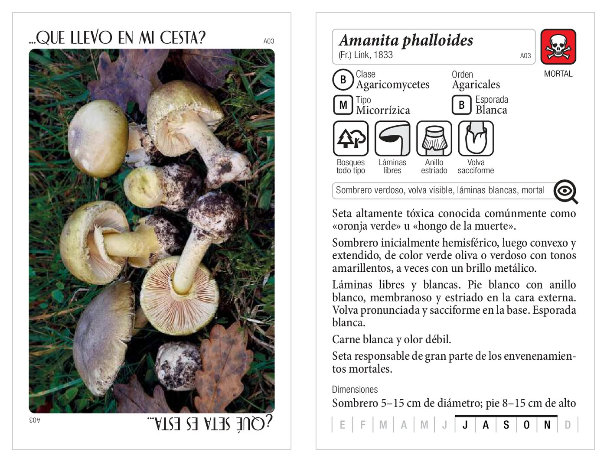

# ¿Qué seta es esta?

**Juego de naipes para aprender a identificar especies de setas** a través de la observación, la deducción y la memoria.

Cada naipe muestra la fotografía de una especie por un lado y, por el otro, su ficha con las características científicas que permiten reconocerla. Está pensado para aficionados, cursos de micología, aulas y cualquiera que quiera aprender los nombres científicos de las setas jugando.

  
   
  <em>Anverso y reverso del naipe A03, <strong>Amanita phalloides</strong>.</em>

> [!WARNING]
> **Este juego es solo educativo y no es una guía de comestibilidad.**
> Nunca consuma setas sin una identificación segura. Los autores declinan cualquier responsabilidad por el uso incorrecto de la información. Para aprender micología, consulte bibliografía especializada y formación con expertos.

## Licencia

Este proyecto se publica bajo licencia **Creative Commons BY-NC-ND 4.0** (Atribución – NoComercial – SinObraDerivada).

✔ Uso personal y educativo  
✔ Impresión para uso propio  
✘ Uso comercial (venta o redistribución comercial)  
✘ Modificaciones o traducciones sin permiso  
✘ Reutilizar textos o fotografías fuera del juego sin autorización

Para permisos comerciales o colaboraciones:
carloscabo AT gmail DOT com

Texto completo en [LICENSE](LICENSE).

## Sobre la baraja

- **78 naipes** de **70 × 110 mm**, uno por especie.
- **Anverso:** fotografía de la seta.
- **Reverso:** ficha de la especie con nombre científico y autor, filo (Ascomycota / Basidiomycota), orden, comestibilidad, hábitat, tipo de himenio, anillo y volva, superficie y textura, color de la esporada, época de fructificación y las **claves de identificación** más importantes.
- **Nombres científicos** contrastados con [MycoBank.org](https://www.mycobank.org/), según el conocimiento aceptado a fecha de enero de 2026. La micología es una ciencia en constante evolución, por lo que algunos nombres pueden cambiar en el futuro.

### Sobre la clasificación utilizada

Para facilitar el aprendizaje y la comparación entre especies, la baraja usa una **clasificación simplificada de los órdenes de los Basidiomycota**, agrupándolos en cinco grandes grupos: *Agaricales*, *Aphyllophorales*, *Boletales*, *Gasterales* y *Russulales*.

Es un enfoque habitual en la enseñanza de la micología que permite trabajar con categorías fáciles de recordar, aunque no siempre coincida con las clasificaciones más detalladas basadas en estudios genéticos recientes. La intención del juego es **divulgar y aprender**, no reproducir al detalle la taxonomía más compleja.

## Descargas

| Fichero | Contenido | Para qué sirve |
|---|---|---|
| [naipes-de-setas-a4-recortables.pdf](naipes-de-setas-a4-recortables.pdf) | 26 páginas A4, 6 naipes por página, alternando anversos y reversos | Imprimir en casa a doble cara y recortar |
| [naipes-de-setas-impresion-casera.pdf](naipes-de-setas-impresion-casera.pdf) | 156 páginas a tamaño naipe (70 × 110 mm), anverso y reverso de cada naipe | Impresoras que admiten tamaño de papel personalizado, copisterías o servicios de impresión de cartas |
| [instrucciones-y-glosario-2026-10-16.pdf](instrucciones-y-glosario-2026-10-16.pdf) | 2 páginas A4 | Significado de los iconos, glosario, partes de una seta y modos de juego |

Estos ficheros son **versiones de baja resolución optimizadas para impresión doméstica**. Si necesitas la versión en alta calidad para imprenta, escribe a los autores (ver [Licencia](#licencia)).

### Consejos de impresión

- Imprime al **100 % / tamaño real**, sin la opción «Ajustar a página», para que los naipes salgan a 70 × 110 mm.
- Imprime a **doble cara**. Antes de imprimir todo, haz una prueba con las dos primeras páginas para comprobar que anversos y reversos coinciden (según la impresora habrá que voltear por el borde largo o por el corto).
- Usa papel grueso o cartulina fina (a partir de unos 250 g/m²) para que los naipes sean manejables.
- Para protegerlos, sirven las fundas de este tamaño que se venden como **Magnum Silver (Lost Cities)** o **Zacatrus Volcano Premium**.

## Modos de juego

En todos los modos **solo se aceptan nombres científicos** (género y especie). Los nombres comunes varían según la región y pueden referirse a especies diferentes; el nombre científico garantiza una identificación precisa y facilita la consulta en guías micológicas.

1. **Identificar especie.** Se saca una carta con la foto visible. Quien la identifique primero anota 2 puntos (1 si solo acierta el género).
2. **Rasgo clave.** Con la foto visible, cada jugador escribe un rasgo correcto de la especie (himenio, hábitat, esporada, época…). 1 punto por rasgo, 2 si está entre las claves de identificación.
3. **Verdadero o falso.** Un jugador enuncia una afirmación (real o inventada) sobre la especie de su carta y el resto responde «verdadero» o «falso».
4. **Memoria visual.** Se colocan 7 cartas con la foto visible y se acuerda qué información hay que adivinar; se comprueba girando cada carta.
5. **Duelo de identificación.** Cada jugador muestra su carta y, por turnos, se eligen categorías (hábitat, tipo de himenio, comestibilidad…); puntúan quienes tengan esa categoría en su carta.

Las reglas completas están en el PDF de [instrucciones y glosario](instrucciones-y-glosario-2026-10-16.pdf).

## Especies incluidas

Ver las 78 especies de la baraja

### Basidiomycota

**Agaricales**

- *Agaricus arvensis* Schaeff., 1774
- *Agaricus xanthodermus* Genev., 1876
- *Amanita caesarea* (Scop.) Pers., 1801
- *Amanita muscaria* (L.) Lam., 1783
- *Amanita phalloides* (Fr.) Link, 1833
- *Amanita rubescens* Pers., 1797
- *Amanita virosa* Bertill., 1866
- *Chlorophyllum venenatum* (Bon) C. Lange & Vellinga, 2008
- *Clitocybe nebularis* (Batsch) P. Kumm., 1871
- *Collybia rivulosa* (Pers.) Z.M. He & Zhu L. Yang, 2023
- *Coprinopsis atramentaria* (Bull.) Redhead, Vilgalys & Moncalvo, 2001
- *Coprinus comatus* (O.F. Müll.) Pers., 1797
- *Cortinarius orellanus* Fr., 1838
- *Cortinarius violaceus* (L.) Gray, 1821
- *Fistulina hepatica* (Schaeff.) With., 1792
- *Galerina marginata* (Batsch) Kühner, 1935
- *Hygrocybe conica* (Schaeff.) P. Kumm., 1871
- *Hypholoma fasciculare* (Huds.) P. Kumm., 1871
- *Lepiota brunneoincarnata* Chodat & C. Martín, 1889
- *Lepiota cristata* (Bolton) P. Kumm., 1871
- *Macrolepiota procera* (Scop.) Singer, 1948
- *Pleurotus eryngii* (DC.) Quél., 1872
- *Pleurotus ostreatus* (Jacq.) P. Kumm., 1871
- *Tricholoma equestre* (L.) P. Kumm., 1871
- *Tricholoma sulphureum* (Bull.) P. Kumm., 1871
- *Tricholoma terreum* (Schaeff.) P. Kumm., 1871

**Aphyllophorales**

- *Cantharellus cibarius* Fr., 1821
- *Clavulina cristata* (Holmsk.) J. Schröt., 1888
- *Craterellus cornucopioides* (L.) Pers., 1825
- *Craterellus tubaeformis* (Fr.) Quél., 1888
- *Fomes fomentarius* (L.) Fr., 1849
- *Hydnum repandum* L., 1753
- *Laetiporus sulphureus* (Bull.) Murrill, 1920
- *Sparassis crispa* (Wulfen) Fr., 1821
- *Trametes versicolor* (L.) Lloyd, 1920

**Gomphales**

- *Ramaria pallida* (Schaeff.) Ricken, 1920

**Boletales**

- *Boletus aereus* Bull., 1789
- *Boletus edulis* Bull., 1782
- *Boletus lepidus* H. Bouchet ex Essette, 1965
- *Boletus pinophilus* Pilát & Dermek, 1973
- *Boletus reticulatus* (Hoffm.) Pers., 1801
- *Hygrophoropsis aurantiaca* (Wulfen) Maire, 1921
- *Imleria badia* (Fr.) Vizzini, 2014
- *Leccinum scabrum* (Bull.) Gray, 1821
- *Neoboletus erythropus* (Pers.) C. Hahn, 2015
- *Paxillus involutus* (Batsch) Fr., 1838
- *Suillellus queletii* (Schulzer) Vizzini, Simonini & Gelardi, 2014
- *Suillus granulatus* (L.) Roussel, 1806
- *Suillus luteus* (L.) Roussel, 1821

**Gasterales**

- *Astraeus hygrometricus* (Pers.) Morgan, 1889
- *Bovista plumbea* Pers., 1796
- *Clathrus archeri* (Berk.) Dring, 1980
- *Crucibulum crucibuliforme* (Scop.) V.S. White, 1902
- *Lycoperdon perlatum* Pers., 1795
- *Phallus impudicus* L., 1753
- *Scleroderma citrinum* Pers., 1801

**Russulales**

- *Lactarius chrysorrheus* Fr., 1838
- *Lactarius deliciosus* (L.) Gray, 1821
- *Lactarius rufus* (Scop.) Fr., 1838
- *Lactarius torminosus* (Schaeff.) Pers., 1797
- *Russula aeruginea* Lindblad, 1861
- *Russula cyanoxantha* (Schaeff.) Fr., 1863
- *Russula nigricans* (Bull.) Fr., 1838
- *Russula sardonia* Fr., 1838
- *Russula vesca* Fr., 1836
- *Russula virescens* (Schaeff.) Fr., 1836

### Ascomycota

**Pezizales**

- *Aleuria aurantia* (Pers.) Fuckel, 1870
- *Ascobolus stercorarius* (Bull.) J. Schröt., 1893
- *Dissingia leucomelaena* (Pers.) K. Hansen & X.H. Wang, 2019
- *Gyromitra esculenta* (Pers.) Fr., 1849
- *Helvella crispa* (Scop.) Fr., 1822
- *Helvella lacunosa* Afzel. ex Fr., 1823
- *Legaliana badia* (Pers.) Van Vooren, 2020
- *Morchella esculenta* (L.) Pers., 1801

**Helotiales**

- *Dasyscyphella nivea* (R. Hedw.) Raitv., 1970
- *Mitrula paludosa* Fr., 1816

**Hypocreales**

- *Cordyceps militaris* (L.) Fr., 1818

**Xylariales**

- *Xylaria hypoxylon* (L.) Grev., 1824

## Autores

- **Carlos Cabo.** Diseño, maquetación y contenidos.
- **Alberto Román Vargas.** Coordinación científica, revisión y todas las fotografías.

## Agradecimientos

A Pili Crego (gracias por revisar) y a l@s compañer@s del curso de micología de La Pardina de Mieres por el apoyo a la idea.

## Erratas y última versión

La última versión del juego está siempre en **<https://bit.ly/que-seta>**.

Si encuentras una errata o un dato a corregir, puedes abrir un [issue en este repositorio](https://github.com/carloscabo/que-seta-es-esta/issues) o escribir a carloscabo AT gmail DOT com.

---

© 2025-2026 Carlos Cabo y Alberto Román Vargas · [CC BY-NC-ND 4.0](https://creativecommons.org/licenses/by-nc-nd/4.0/deed.es) · Ver [LICENSE](LICENSE)
